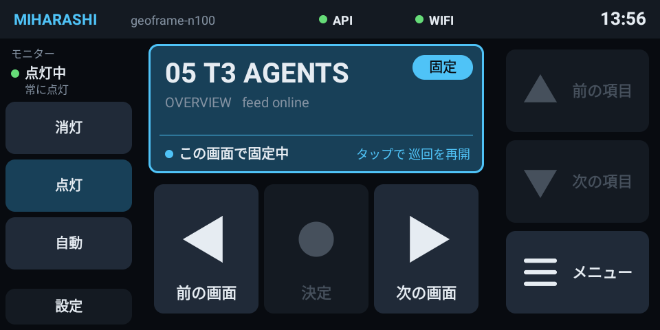

# Miharashi Panel

**手元の小さな画面から、モニターを操作する。**

[Miharashi](https://github.com/ysogabe/miharashi) を手元で操作する Android アプリです。Android 化した Echo Show 5 を専用の操作盤にして、画面の切り替えやモニターの消灯・点灯を操作できます。

**紹介ページ(LP): https://ysogabe.github.io/miharashi-panel/**

## できること

- **見たい画面を選ぶ**: 前後のボタンで切り替えたり、メニューの一覧から直接選んだりできます。
- **画面に合わせて操作する**: 写真の前後移動など、その画面でできる操作をボタンの説明で案内します。
- **好きな画面で固定する**: 自動巡回の状態と再開までの残り時間を表示し、巡回の停止・再開も操作できます。
- **モニターを手元から操作する**: Home Assistant と連携した本体に、消灯・点灯・自動の切り替えを送ります。
- **本体の状態を確認する**: 表示中の画面名や写真の何枚目か、接続状態が手元で分かります。
- **触らなければ時計を表示する**: 初期設定では 3 分で低輝度のフリップ時計に切り替わります。触ると操作盤に戻り、最初のタッチでは操作を送りません。

## 動作環境

Android 化した Echo Show 5（LineageOS 18.1、Android 11、960×480）で使用しています。アプリの最小対応は Android 11（API 30）ですが、ほかの端末での動作は未確認です。Echo Show の Android 化の手順は、このリポジトリでは扱いません。

接続先は、同じ LAN にある Miharashi 本体の panel API です。URL と認証用トークンを設定して使います。モニターの操作には本体の Home Assistant 連携、巡回の固定・再開には本体の自動巡回設定と対応 API が必要です。

## いまの状態

v0.2.0 では、メニューからの画面選択、画面に応じたボタンの説明、自動巡回の状態表示と固定・再開に対応しています。端末起動時の自動表示と、無操作時の低輝度時計表示にも対応しています。

画面や巡回の状態は本体から取得します。端末に保存するのは接続先などの設定だけです。夜間だけ明るさを変える機能は作らず、無操作時の低輝度時計表示で減光します。

## 使う・開発する

ビルドと端末への導入は [使い方](docs/USAGE.md)、アプリの構成は [技術設計](docs/DESIGN.md) にまとめています。文書の一覧と確認状況は [Docs](docs/README.md)、紹介ページの更新と公開手順は [LP の管理](docs/LP.md) を参照してください。
