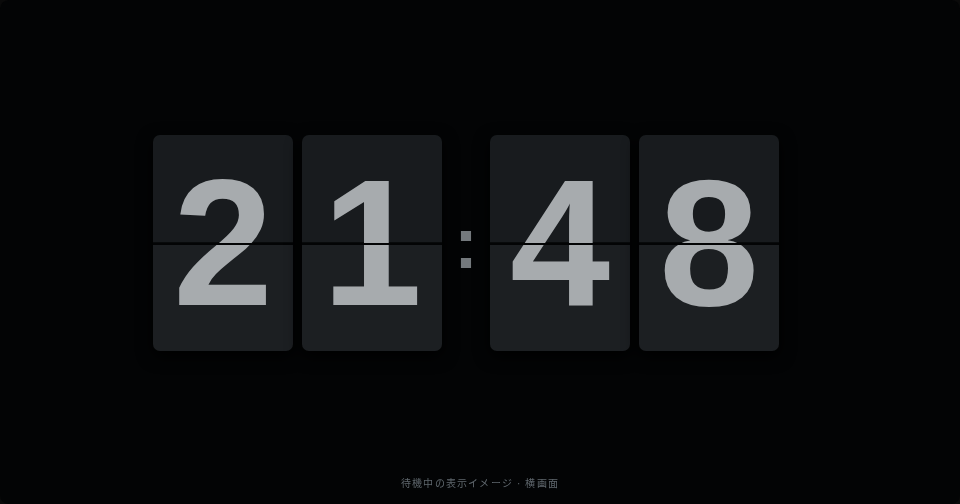
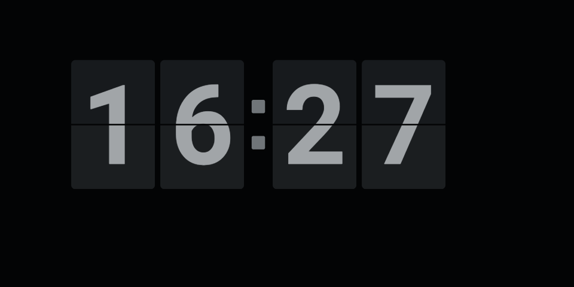

# 無操作時のフリップ時計

2026-10-17 承認済み画面案。従来の自動消灯を、大きな時計の待機表示へ置き換える。

## 画面

画像は画面案であり、Android 実機のスクリーンショットではない。数字は最初の案から約1.4倍に拡大済み。画像中の「待機中の表示イメージ」は説明用で、製品には表示しない。[操作できる画面案](images/idle-flip-clock.html)も保存する。

- 横向き全画面。黒背景、暗いカード、明るさを抑えたグレーの数字。
- 端末の現地時刻を24時間制の `HH:mm` で表示。秒、日付、ロゴ、常設の復帰案内は省く。コロンは点滅させない。
- 数字4桁を大きく表示し、960×480を基準に時計全体で幅約626、高さ約216を目安とする。小さい表示領域でも移動余白を含めて収める。
- 分が変わると、変わった桁だけ約450msかけて上半分が手前へ倒れ、下半分へ落ちる。上と下を別々に描画し、継ぎ目と陰影でフリップを表現する。
- 待機に入った直後、時刻の大きな補正、前面への復帰では、現在時刻を直接表示して不要な連続フリップを避ける。

## 画面遷移

| 現在 | 条件 | 遷移・動作 |
|---|---|---|
| 操作盤 | 無操作が設定時間に到達 | 低輝度のフリップ時計へ |
| 操作盤 | タッチ | 待機時間をリセット |
| フリップ時計 | 分の切替 | 変化した桁だけフリップ |
| フリップ時計 | どこかをタッチ | 操作盤へ復帰し、通常の明るさに戻す |
| 復帰直後 | 復帰に使った指が離れるまで | 一連のジェスチャーを消費し、本体に操作を送らない |
| 設定画面から戻る／再び前面になる | onResume | 操作盤を表示し、待機時間を数え直す |
| アプリが背面になる | onPause | 描画更新・アニメーションの予約を停止 |

初期値3分、設定範囲0〜240分、0は無効。保存済みの `sleep_minutes` をそのまま利用する。設定画面の表示文言は「時計表示まで」に変更する。時計表示中も前面にいる間は本体の状態同期を続ける。復帰タッチの次の操作から通常どおり送信する。

## 残像と消費電力への配慮

- 時計全体（カード・数字・コロン）を画面内で緩やかに移動させる。960×480基準で左右約48、上下約32を目安にし、画面サイズから安全な範囲を算出する。
- 移動は急に飛ばさず、長い周期で連続的に変化させる。数字とカードの濃淡も緩やかに少し変える。毎分の数字変更だけに依存しない。
- 待機中のバックライトは低輝度（ウィンドウ指定5%を初期値）とし、復帰時はシステム設定に戻す。実際の明るさは端末によって異なる。
- フリップ中だけフレーム単位で更新し、通常の待機中は低頻度で更新する。背面やViewの破棄後は更新を止める。
- 低輝度と移動で残像リスクを下げるが、焼き付き防止を保証するものではない。実機で最低輝度、数字の読みやすさ、長時間表示、画面端の欠けを確認する。

## 実装・検証の分担

- Luna: Activityの低輝度制御・前面状態の通知、設定文言・関連する利用文書の更新。
- Sonnet: Canvasの時計描画、フリップ、移動・濃淡、待機・復帰と描画スケジューリング、ロジックのテスト。
- Opus: 統合後のレビュー（時刻境界、誤操作、ライフサイクル、描画負荷、移動範囲）。
- オーケストレータ: 仕様と画像の保存、分担・統合、検証結果の整理。

`./gradlew testDebugUnitTest assembleDebug` を基本確認とし、実機試験と区別して結果を報告する。

## 検証記録

2026-10-17: `./gradlew testDebugUnitTest assembleDebug` 成功。単体テスト61件（時計ロジックの新規24件を含む）、失敗・エラー0件。debug APKを生成済み。画像は承認済みの画面案であり、Canvas描画の実機確認結果ではない。フリップの見た目、最低輝度の読みやすさ、長時間表示と残像は実機未確認。

Opus初回レビュー: 重大な問題なし。保存画像とのカード寸法差は画像に合わせて修正済み。待機の設定時間を過ぎてから次の画面更新まで（最大約1秒）のタッチも復帰として扱う挙動は、誤送信防止のため維持する。

Opus最終レビュー: 寸法・関連テスト・文書の整合を確認し承認。修正後の `testDebugUnitTest assembleDebug` も成功。未解決の実害や新しい退行の指摘なし。実機の見た目・5%輝度の読みやすさ・長時間残像は未確認のままとする。

## 実機への適用と確認

2026-10-17: USB接続した Echo Show 5（LineageOS）に `./scripts/install.sh` でdebug APKを上書き適用し、起動成功。既存の接続設定と待機3分を維持した。API・Wi-Fiの接続表示、3分の無操作での時計切替、数字が画面内に収まることを実機画面の取得で確認した。時計表示中にメニューボタン位置をタッチして操作盤へ復帰し、メニューが開かないことも確認した。適用後のAndroidRuntimeエラーログは検出されなかった。

この画像は実機スクリーンショット。バックライトの実際の明るさはスクリーンショットには反映されないため、5%輝度での肉眼の読みやすさ、フリップの連続動作、長時間表示の残像は引き続き未確認。先の検証記録の実機未確認事項のうち、基本表示・自動切替・復帰はこの確認で更新した。

利用者による実機動作確認: 2026-10-17、動作を確認し、この内容で承認された。長時間表示の残像評価は別途とする。
