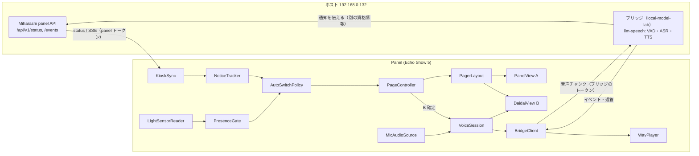
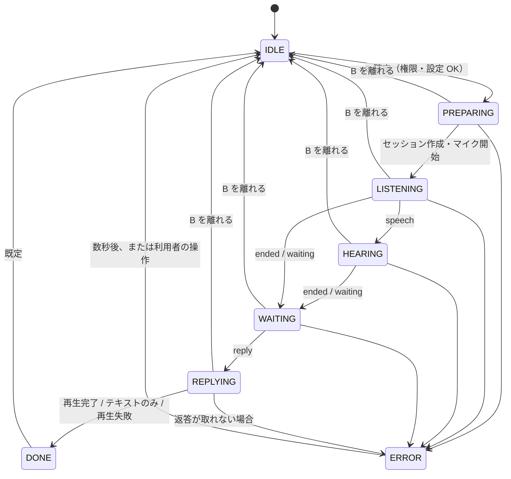

# だいだい連携画面 設計

PRD: [prd.md](prd.md)（要求 R1〜R20、受け入れ条件 AC1〜AC20）。Issue: [miharashi-panel #17](https://github.com/ysogabe/miharashi-panel/issues/17)。

2026-11-08 版（レビュー反映後）。設計フェーズの成果物で、アプリのコードは変更していない。調査で見た事実には `path:line` を付ける（パスは `app/src/main/java/io/github/ysogabe/miharashi/panel/` を `P/` と略す）。判断が要る点は「未決・要判断」とし、§12 に集約した。

## 1. 概要

操作画面（A）の隣に、だいだい連携画面（B）を足す。左右スワイプで行き来する。

- B に入ると、専用ボタンなしでマイクが開き、音声を小さなチャンクでホストのブリッジへ送り続ける。発話の終了はホスト側 VAD が決める。返答（テキスト＋ TTS 音声）は B に表示し、Echo Show のスピーカーで再生する。
- だいだいから通知が来たら、**在席ゲート**を通ったときだけ B へ自動で切り替わる。初期のゲートは照度センサーで、真っ暗が続いているときは切り替えない。ゲートは画面切替の本体から分離し、将来の在席判定に差し替えられる。
- 通知の到来は、Miharashi の panel API の status / SSE（既存の購読経路）で知る。音声は別のブリッジ（ホスト側）とやり取りする。**ブリッジのトークンは panel のトークンとは別にする。**
- 画面 A の機能・見た目は変えない。
- 初版の範囲: 在席ゲートは照度 1 つ（差し替え用のインターフェースは置く）、通信は T1（HTTP + SSE）1 本、**1 回の入場につき 1 往復、返答は 1 件**。連続会話・分割返答・ゲートの合成は初版に入れない（§12）。

## 2. 今の作り（調査結果）

### 2.1 画面と状態

- 唯一の Activity `PanelActivity` が `setContentView(view)` で Canvas 描画の `PanelView`（733 行）を 1 枚置くだけ。Fragment や遷移の仕組みはない（`P/PanelActivity.kt:87`）。設定は別 Activity `SettingsActivity`（`AndroidManifest.xml:37-41`）。
- 画面は 960×480 を基準に拡大縮小する `PanelLayout`（`P/PanelLayout.kt:44-55`）。ボタンは `Button(id, icon, label, action, box, enabled)` で `hit(x,y)` 判定（`PanelLayout.kt:92`）。`Action` は `Key / Display / Screen / Rotation / Settings` の sealed interface（`PanelLayout.kt:16-31`）。
- **スワイプ検出は今ない。** `PanelView.onTouchEvent` は DOWN で押下 id を記録し、UP で同じ id なら tap にするだけ（`P/PanelView.kt:620-657`）。CANCEL では `pressed=null` に戻す（`:651`）。端のスワイプはシステムバー表示用の `BEHAVIOR_SHOW_TRANSIENT_BARS_BY_SWIPE` だけ（`P/PanelActivity.kt:184-190`）。
- 状態は本体の値を写した不変オブジェクト `PanelState(status, lastOkAtMs, lastError)`（`P/PanelState.kt:131-164`）。アプリは画面状態を端末に保存しない（`docs/DESIGN.md:5-11`）。
- Activity は常時点灯・全画面・横固定。`onResume` で同期を作り、`onPause` で捨てる（`PanelActivity.kt:90-135`）。`launchMode=singleTask`、`HOME` にも指定可（`AndroidManifest.xml:19-34`）。`PanelActivity` は `exported=true`。

### 2.2 無操作時のフリップ時計

- 時計は **`PanelView` の内部状態**。`IdleTimer`（最後のタッチ時刻だけを持つ。`P/IdleTimer.kt`）と `sleeping` フラグを `PanelView` が持ち、眠っている間は `onDraw` が `drawFlipClock` に分岐する（`PanelView.kt:77-87`, `148-159`, `227-231`）。
- 入る条件: 無操作が `sleep_minutes`（既定 3 分、0 で無効）に達する。ティッカーが 1 秒ごと（眠っている間は分の境目まで）に `updateSleep()` を呼ぶ（`PanelView.kt:114-134`）。
- 戻る条件: どのタッチも `wake()`。眠っている最初の DOWN は `swallowing=true`（**private**）にして、UP/CANCEL まで一連のイベントをボタンに渡さない（`PanelView.kt:90`, `620-631`）。`onResume` でも `view.wake()`（`PanelActivity.kt:112`）。
- 眠る／起きるたびに `onSleepChanged` が Activity に届き、`setBacklight` が明るさを決める（`PanelActivity.kt:76`, `142-150`）。**明るさは、自動調光が有効で照度が取れていれば時計中も照度式に従い、照度が取れない・自動調光が無効のときだけ 5%（起きている間はシステム設定）になる**（`P/AmbientLight.kt:8-10`）。
- 眠っている間は `state` の更新で再描画しない（`PanelView.kt:56-70`）。**通知で A から B へ切り替えるときは、先に `wake()` で時計を解除する必要がある。**

### 2.3 照度センサーと暗闇消灯

- `LightSensorReader` が `TYPE_LIGHT` を `SENSOR_DELAY_NORMAL` で購読する。不正値・センサーなし・登録失敗では `onLux(null)` を通知する（`P/LightSensorReader.kt:24-25`, `33-45`）。購読は `autoBrightness || darkOff` のときだけ `onResume` で開始、`onPause` で停止し `lux=null` に戻す（`PanelActivity.kt:118`, `125-126`）。
- `DarknessPolicy`: 閾値（既定 1 lx、設定可、0〜100）以下が `DELAY_MS=30_000` 続いたら `force_off` を一度だけ送る（`P/AmbientLight.kt:24-68`）。`darkSince` は `handled` が立つと `null` のままになる（`AmbientLight.kt:38`, `46`）。**つまり一度消灯を送ったあとは、暗闇の継続時間を返せない。ゲートには流用できない**（§4.5 で別クラスにする）。
- 照度は `AmbientBrightness`（調光）、`AmbientContrast`（10〜250 lx で配色補間）にも使われ、`PanelActivity.setBacklight` が `PanelView.contrastStrength` に流す（`AmbientLight.kt:7-21`, `PanelActivity.kt:142-150`）。**B の描画にも同じコントラスト値を与える必要がある。**
- Android の on-change 型センサーは登録時に現在値を一度返すのが仕様。実機（Echo Show 5）で確認が必要（§12 O-13）。

### 2.4 設定の保存

- `Settings` は SharedPreferences `"panel"`（`MODE_PRIVATE`）。キーは `url`, `token`, `sleep_minutes`, `auto_brightness`, `dark_off`, `dark_lux`。検証付きの一括 `save(...)` があるが、引数が 6 個で、項目を足すと膨らむ（`P/Settings.kt:6-70`）。`url` / `token` の個別セッターは検証を通らない。`validate` はユーザー情報・クエリ・フラグメントを拒否しない（`Settings.kt:57-67`）。
- `SettingsActivity` は XML を使わず `LinearLayout` をコードで組む。トークンはマスク、「接続テスト」は別スレッドで `KioskClient.status()`、保存は検証後に `save`（`P/SettingsActivity.kt:38-179`）。センサーの状態を 1 行出す前例がある（`:77-84`）。
- 接続先の変更は `onResume` で検知し、状態と `darkness` を作り直す（`PanelActivity.kt:102-109`）。`scripts/install.sh` は debug ビルドで `run-as` により `shared_prefs/panel.xml` を **丸ごと書き直す**（`scripts/install.sh:36-52`）。`$sleep_xml` は `printf` の書式文字列の側に埋め込まれている。

### 2.5 panel API クライアント

- `KioskClient`: `HttpURLConnection`、同期ブロッキング（UI スレッド禁止）、接続 3 秒・読み取り 5 秒、全リクエストに `Authorization: Bearer`。URL は `URL("$base$path")` で連結（`P/KioskClient.kt:12-49`）。
- status: `GET /api/v1/status`。SSE: `GET /api/v1/events`（読み取り 40 秒、keepalive は 15 秒ごと）で、**`event: status` だけを処理し、他のイベント名は捨てる**（`KioskClient.kt:78-109`）。`SseParser`（`:112-140`）は `event:` と `data:` だけを扱い、**`id:` は保持しない**。`Backoff`（1,2,4…30 秒、`:142-151`）は再利用できる。
- `KioskSync`: 5 秒間隔のポーラー、SSE スレッド、送信用の単一スレッド。SSE とポーリングは並行して走り、**到着順に反映する**（古いスナップショットが後着し得る）。結果は `Handler(mainLooper)` で UI スレッドへ（`P/KioskSync.kt:14-113`）。同期は Activity が前面の間だけ。
- `KioskStatus.parse` は知らない項目を無視する。`schema_version` が新しくても知っている項目だけ読む（`PanelState.kt:60-117`）。旧本体の欠落項目は null として扱う互換ルールがある（`docs/DESIGN.md:106-116`）。**`daidai` ブロックを足しても旧 Panel / 旧本体とも壊れない。**
- 現行の依存は実行時ゼロ。テストは JUnit 4.13.2、Robolectric 4.14.1、org.json、MockWebServer 4.12.0（`app/build.gradle.kts:45-52`）。coroutines も OkHttp 本体もない。AGP 8.7.3、Kotlin 2.1.0、Gradle 8.11.1、compile/target 35、min 30（`build.gradle.kts:1-4`, `app/build.gradle.kts:6-16`）。

### 2.6 権限・テスト・CI

- 権限は `INTERNET`, `ACCESS_NETWORK_STATE`, `RECEIVE_BOOT_COMPLETED`, `SYSTEM_ALERT_WINDOW`。`RECORD_AUDIO` は未宣言。cleartext は全体で許可（`network_security_config.xml:2-4`）。
- テストの様式: 純 JVM（`IdleTimerTest`, `AmbientLightTest`）、Robolectric の描画比較（`AmbientClockDrawingTest`）、Activity 統合（`LightSensorReaderTest`、`ShadowSensor`）、仮想時計つきの `IntroVideoTest.Demo`（`tap(box)`, `advance(ms)`, `bitmap()`）、MockWebServer（`KioskClientTest`）、fixtures 10 個（`app/src/test/resources/fixtures/`）。
- CI は `.github/workflows/pages.yml`（LP の公開）のみで、Gradle を回すものはない。

## 3. 方針

### 3.1 2 画面の作り方

| 案 | 内容 | 判断 |
|---|---|---|
| **P1: 自前の `PagerLayout`（採用）** | `FrameLayout` に `PanelView`（A）と新設の `DaidaiView`（B）を置き、横ドラッグを `onInterceptTouchEvent` で奪って 2 枚を平行移動する | 依存ゼロ。既存の Canvas 流儀と合う。`PanelView` の CANCEL 処理がそのまま使える |
| P2: ViewPager2 | AndroidX の ViewPager2 + Fragment | RecyclerView / Fragment などの依存が増える。基底が `android.app.Activity` で AppCompat もなく、合わない |
| P3: `PanelView` に B も描く | 1 つの View の中でページ状態を持つ | 733 行がさらに肥大し、時計・タッチ・描画が絡む。回帰リスクが高い |
| P4: 別 Activity | B を Activity にして遷移 | スワイプの追従アニメーションが作れない。`singleTask`/HOME/キオスクの前提と相性が悪い。ライフサイクルが 2 倍になる |

### 3.2 待機時計との関係

時計は A に属したまま変えない（P3 を避ける理由の一つ）。

- **時計からの復帰は常に A。** 時計が出ているとき最初のタッチは今までどおり「時計を消すだけ」。
- **B は B 自身の無操作タイマー**（`daidai_idle_seconds`、既定 60 秒）で A に戻す。タイマーはセッション進行中は止めるが、進行中の状態はすべて有限の期限で終わる（§5.2.6）ので、止まったままにはならない。A に戻ると A の `IdleTimer` が数え直しになり、その後 `sleep_minutes` で時計に入る。
- B の表示中は A の `IdleTimer` を**保留**する（新設の `PanelView.idleSuspended`）。保留しないと、B で会話している最中に A 側のタイマーが満了し、`onSleepChanged(true)` で時計用の輝度設定に切り替わる（§2.2）。保留を解いて A に戻るときは、**先に `IdleTimer` を触れた扱いにしてから**保留を外す（戻った瞬間に時計が一瞬出るのを避ける）。
- 通知の自動切替は時計中でも動く。`wake()` で時計を解除し、B へ切り替える。

代替案: 「時計に入る直前のページに戻る」。却下の理由は、B はマイクが開く画面なので、誤タッチで時計から戻っただけで録音が始まるのを避けたい。**ただし利用者の判断事項**（O-1）。

### 3.3 通知の信号経路

| 案 | 内容 | 判断 |
|---|---|---|
| **N1: status に `daidai` ブロックを足す（採用）** | 既存の `GET /api/v1/status` と SSE `event: status`（全体スナップショット）に載せる | 新しい接続・スレッド・認可が要らない。5 秒ポーリングが取りこぼしの保険になる。旧 Panel は無視する |
| N2: SSE に別イベント名（`event: daidai`） | `KioskClient.events` の振り分けを拡張 | 低遅延だが、ポーリングによる保険がなく、別途 status への露出も要る |
| N3: ブリッジ側の別 SSE を購読 | 音声と同じ接続先で通知も受ける | Panel の購読が 2 本に増える。Issue の前提（Miharashi の panel API に露出）と違う |

採用は N1。Miharashi 本体が `daidai` ブロックを返し、ブリッジの通知を受けて status を更新して SSE に流す（本体側の対応はホスト側ブリッジ Issue に含める。Issue 記載のとおり）。

### 3.4 音声の転送

Panel が要求するのは「順序つきのチャンク送信」「ホストからのイベント通知（再生可能）」「返答音声の取得」の 3 つ。転送方式は次の 2 案で、**確定はホスト側 Issue**（O-4）。

| 案 | 内容 | Panel から見た評価 |
|---|---|---|
| **T1: HTTP + SSE（Panel の希望）** | チャンクごとに `POST`、状態・返答は SSE、返答音声は `GET` | 追加依存ゼロ。`HttpURLConnection` / `SseParser`（`id:` の保持を足す）/ `Backoff` と MockWebServer テストを再利用。各チャンクに ack が返り、`ended` で即座にマイクを止められる。SSE の再接続は要る |
| T2: WebSocket | 1 本の接続で PCM フレームを上り、JSON を下り | 双方向で素直。ただし Android 標準に WebSocket クライアントがなく、OkHttp を実行時依存に足す。再接続・生存監視は T1 の SSE と同様に要る |

Panel 側は `BridgeApi` のインターフェースの裏に隠す（テストの偽物を差すためにも必要）。T2 になっても差し替えられるが、初版は T1 の実装 1 つだけ作る。

## 4. 構成

### 4.1 モジュール

新設（`P/` 配下。`daidai/` サブパッケージにまとめる案。名前は実装時に確定）:

| モジュール | 種別 | 役割 |
|---|---|---|
| `PageController` | 純 Kotlin | 現在ページ（A/B）と遷移理由（`SWIPE`, `AUTO_NOTICE`, `IDLE_RETURN`, `RESUME`）。**「確定（settled）」イベントを出す**（アニメーション終了時）。B への入場処理は確定イベントでだけ一度行う |
| `SwipeDecision` | 純 Kotlin | 距離・速度・方向から「ページ送りか／戻るか」を決める。しきい値は `ViewConfiguration` から渡す |
| `PagerLayout` | View | 2 枚の子を持ち、横ドラッグの奪取・追従・スナップを行う。ページ点（● ○）を描く |
| `DaidaiController` | 非 View | 下記すべてを束ね、Activity のライフサイクル（`start`/`stop`）に合わせる。`PanelActivity` の肥大を避ける |
| `DaidaiView` / `DaidaiLayout` | View / 純 | B の描画と配置（960×480 基準、`PanelLayout` と同じ拡縮の流儀） |
| `DaidaiUiState` | 純データ | B が描くもの全部（状態、ポーズ、通知、認識テキスト、返答、エラー）。保存しない |
| `PresenceGate`（interface）, `AmbientLightGate`, `LuxDarkTracker` | 純 Kotlin | §4.5 |
| `NoticeTracker` | 純 Kotlin | status から新着通知を取り出す。§4.4 |
| `AutoSwitchPolicy` | 純 Kotlin | 新着通知＋ゲート判定＋設定＋現在の状態から「切り替える／見送る（理由）」を返す。自動起動のマイクの歯止め（§7）もここ |
| `VoiceSession` | 純 Kotlin | 音声セッションの状態機械。**単一スレッド（`HandlerThread`）でイベントを直列処理**する。依存は `AudioSource`, `BridgeApi`, `ReplyPlayer`, `Clock` の interface だけ |
| `MicAudioSource` | Android | `AudioRecord`（16 kHz / mono / PCM16）。読んだ PCM を `VoiceSession` に渡す |
| `BridgeClient` | Android 寄り | `BridgeApi` の実装。`KioskClient` と同じ流儀（`HttpURLConnection`）。URL は §5.2.0 のとおり自分で組む |
| `WavPlayer` | Android | 返答の WAV を**メモリ上**で検証し、`AudioTrack` で再生する。ファイルに書かない。AudioFocus を取る |
| `AvatarAssets` | Android | ポーズ別のドット絵（APK 同梱の案、O-6） |

変更する既存コード（影響を最小に）:

- `PanelActivity`: `PanelView` を直接 `setContentView` せず `PagerLayout` に載せる。`DaidaiController` の生成・`start`/`stop`・`onKioskState` からの `NoticeTracker` への転送・照度の転送・`setBacklight` のコントラスト値を B にも渡す。照度購読の条件に「自動切替が有効」を足す（`PanelActivity.kt:118`）。**Intent の extras からページ指定やマイク起動を受けない。`onResume` は常に A から始める**（不変条件）。
- `PanelView`: `idleSuspended`（B 表示中は無操作判定を保留）と、時計から復帰中のジェスチャを `PagerLayout` に知らせる読み取り専用の `gestureSwallowed`（`swallowing` の公開版）。タップ・描画・時計は変えない。
- `SseParser`: `id:` を保持する、1 行 8 KB・1 イベント 16 KB の上限を設ける（`KioskClient` にも効く。上限超過は接続を切る）。
- `KioskStatus.parse`: `daidai` ブロック（任意）を読む。`KioskStatus` に `daidai: DaidaiInfo? = null` を追加。
- `Settings` / `SettingsActivity`: 新しい設定項目（§5.1）。`save` の引数爆発を避けるため、設定値をまとめるデータクラスを導入（O-12）。`daidai_url` の検証を厳しくする。
- `AndroidManifest.xml`: `RECORD_AUDIO` を追加。
- `scripts/install.sh`: `pm grant … RECORD_AUDIO` を追加。ブリッジ接続先の書き込みオプションを追加するときは、**指定していない既存の設定を消さない**ようにする（§8）。
- 文書: `docs/DESIGN.md`, `USAGE.md`, `IDLE_CLOCK.md`（画面遷移表に B を追記）, `README.md`。

### 4.2 データの流れ



### 4.3 ページ遷移表

| 現在 | 契機 | 結果 |
|---|---|---|
| A | 左へスワイプ（距離 ≥ 幅の 25% か速度 ≥ 閾値） | B へ。**スナップが完了（settled）してから**音声セッション開始（`ENTRY_DEBOUNCE_MS`＝300 ms 後）。ドラッグ途中で B が半分見えている間はマイクを開かない |
| B | 右へスワイプ | セッション取消・マイク停止・再生停止。A へ |
| A（時計表示中） | タッチ | 従来どおり時計を消して A（B ではない）。**そのジェスチャの残りの MOVE では Pager は奪わない**（§5.7） |
| A（時計表示中） | 通知＋ゲート通過 | `wake()` で時計解除 → B へ（`AUTO_NOTICE`） |
| A（時計表示中） | 通知＋ゲート不通過 | 何もしない（通知は溜まる） |
| B | `daidai_idle_seconds` 無操作（セッションが IDLE / DONE / ERROR のとき） | A へ（`IDLE_RETURN`）。A の無操作タイマーはここから数え直し |
| B | セッションが進行中 | 無操作タイマーを止める。進行中の各状態は有限の期限を持つ（§5.2.6） |
| B | 通知が来た（すでに B にいる） | カードを更新するだけ。切替もセッション再開もしない |
| A（ドラッグ中・アニメーション中） | 通知が来た | 利用者の操作を優先して見送る。**確定後に一度だけ再評価**する（候補の `age_s` が上限内で、まだ A にいれば切り替える） |
| 自動切替のアニメーション中 | 指が触れた | 進行中のアニメーションは完了させる（巻き戻さない）。その後の操作は通常のスワイプ |
| いずれか | `onPause`（背面） | アニメーション停止、セッション取消、ページを A に戻す。次の `onResume` は A から始める（画面状態を保存しない既存方針） |
| いずれか | 設定画面を開く | A からのみ（B に設定ボタンはない）。戻ると A |

### 4.4 通知の検知（`NoticeTracker`）

入力は `KioskStatus.daidai`（§5.3）。出力は「新着の通知 1 件」または何もなし。

1. **新旧の判定は `daidai.rev`（ホストが付けるスナップショットの版番号）で行う。** `rev` が既に見たものより小さいスナップショットは丸ごと捨てる（SSE とポーリングの後着、遅延応答に対する防御。`age_s` は応答生成時の値なので、遅れて届いたスナップショットを新鮮と誤判定しうる）。`rev` が無い旧ホストなら、自動切替は行わず通知の表示だけにする。
2. `notices[].id` を最大 64 件の既知集合で重複排除する。
3. **基準（baseline）:** `onResume` のたびに（＝`KioskSync` を作り直すたびに）、また接続先が変わったときに、基準を取り直す。「最初に正常に解釈できた status」に含まれる通知はすべて既知にするだけで切り替えない。したがって、背面・設定画面にいた間に来た通知、アプリ起動前の通知、起動から最初の status までに来た通知では自動切替しない（未読としては残る）。
4. 以降に新しく現れた id のうち、`age_s` が `AUTO_SWITCH_MAX_AGE_S`（既定 30）以内で、`priority` が `low` でないものだけを自動切替の候補にする（R20）。候補が複数なら最新のもの。見送った通知も既知集合に入れるので、あとで同じ通知で切り替わることはない（R18 を採る場合のみ別扱い、O-9）。
5. 候補は `AutoSwitchPolicy` に渡す。

保持と既読（初版で保証する範囲）: ホストは最新 5 件を返す。Panel は B に**最新 1 件をカード表示**し、残りは「他 N 件」と件数だけ示す。「未読」は、`daidai.ack` が `true`（ホストが既読を管理する）なら `daidai.unseen` を使い、そうでなければ Panel が数える。**Panel のローカル既読規則:** B が確定して 2 秒以上表示されたら、その時点の通知をすべて既読にする（メモリのみ）。ack 対応のホストには `POST /api/v1/daidai/ack` で伝える。

### 4.5 在席ゲート（切替本体との分離）

```kotlin
enum class Presence { PRESENT, ABSENT, UNKNOWN }

data class GateVerdict(val presence: Presence, val reason: String)   // reason は診断表示用

fun interface PresenceGate { fun evaluate(nowMs: Long): GateVerdict }
```

- `AutoSwitchPolicy` は `PresenceGate` だけを知る。照度センサーも設定値も知らない。
- 初期実装 `AmbientLightGate(sample: () -> LuxSample, config: () -> GateConfig)`:
  - 照度が不明（`null`）→ `UNKNOWN`（reason: `lux_unavailable`）。
  - 暗闇が `config.darkSeconds` 以上続いている（`lux ≤ config.darkLux`）→ `ABSENT`（`dark`）。
  - それ以外（明るい、または暗くなって間もない）→ `PRESENT`（`bright`）。
- 暗闇の継続時間は **新設の `LuxDarkTracker`** で数える。既存 `DarknessPolicy` は `handled` が立つと継続時間を返せず、閾値の上限や rearm の意味も違うため、流用しない（§2.3）。既存クラスは触らないので、暗闇消灯の回帰リスクはない。`LuxDarkTracker` は `LightSensorReader` のコールバックに相乗りする（購読はひとつ）。
- **リセット条件:** `onPause`、照度が `null` になったとき、閾値または継続秒数の設定が変わったときは、暗闇の開始時刻を捨てる（古い開始時刻と新しい閾値を混ぜない）。
- 自動切替の判定は **`PRESENT` のときだけ切り替える**（`ABSENT` も `UNKNOWN` も切り替えない。R9 の安全側）。
- 将来、在席信号が増えたときの合成（`CompositePresenceGate`）は、その時点で実装する（初版には入れない。合成規則は O-8）。
- 判定の結果（理由・照度・継続秒）は直近 1 件を保持し、設定画面に 1 行表示する。実機検証（AC9）で「なぜ切り替わらなかったか」が分かる。

照度が取れない場合の扱い:
- センサーなし／登録失敗／`onResume` 直後で最初の値が未着 → `UNKNOWN`（切り替えない）。
- 値が古いかどうかは見ない（on-change 型は変化がなければイベントが来ないため）。

## 5. インターフェース

### 5.1 設定

`SharedPreferences "panel"` に追加（既存キーは変えない）:

| キー | 型 | 既定 | 範囲／検証 | 意味 |
|---|---|---|---|---|
| `daidai_url` | String | 空 | §5.1.1 | ブリッジの接続先。空なら音声機能は完全に無効（B は案内を出す） |
| `daidai_token` | String | 空 | 16 文字以上。**`token`（panel）と同じ値は拒否** | ブリッジ専用のトークン。**panel のトークンは流用しない・送らない**。未設定なら B は「未設定」の案内 |
| `daidai_auto_switch` | Boolean | true | | 通知での自動切替 |
| `daidai_gate_dark_lux` | Float | 1.0 | 0〜100 | 「真っ暗」の閾値（既存 `dark_lux` の既定に合わせる） |
| `daidai_gate_dark_seconds` | Int | 30 | 0〜600 | 暗闇がこの秒数続いたら見送る（既存の消灯の 30 秒に合わせる） |
| `daidai_auto_listen` | Boolean | true | | 自動切替で入ったときもマイクを開く（O-2 で「開く」に決定済み。歯止めは §7） |
| `daidai_idle_seconds` | Int | 60 | 10〜600 | B で無操作のとき A へ戻すまで |

`dark_lux`（自動消灯）と別キーにする理由: 消灯の閾値を動かしたときに自動切替の判定が連動して変わるのを避ける。ただし共有のほうが分かりやすいという判断もあり得る（O-7）。設定画面には「だいだい連携」の節を足し、接続テスト（`GET /v1/health`）を置く。

#### 5.1.1 `daidai_url` の検証

`java.net.URL` として解釈したうえで、次をすべて満たすものだけを受け付ける: scheme が `http` か `https`、host がある、**ユーザー情報（`user@`）・クエリ・フラグメントがない**。パスの接頭辞は許す（末尾の `/` は正規化）。既存 `Settings.validate` はこれらを拒否しないので、新しい検証関数を足す。

### 5.2 ブリッジインターフェース要求仕様（ホスト側 Issue の元）

Panel が相手（ホスト側ブリッジ）に要求する契約。**転送方式は T1（HTTP + SSE）を Panel の希望として具体的に書く。** T2（WebSocket）になる場合も、論理的な要求（チャンクの順序と冪等、イベントの再生、期限、エラー）は同じとして読み替えてほしい。

#### 5.2.0 共通

- **URL の組み立て:** Panel は `daidai_url`（§5.1.1）に、この文書で決めた固定のパス（`/v1/voice/...`）を足して自分で組む。ホストの応答に含まれるパスや URL は**使わない**（別ホストへ誘導されるのを防ぐ）。`session_id` は `^[A-Za-z0-9_-]{1,64}$` に一致しなければセッション作成の失敗として扱い、`index` は整数に限る。リダイレクト（3xx）は追従せずエラーにする。パス接頭辞を変えたいときは `daidai_url` に含める。
- **認証:** 全リクエストに `Authorization: Bearer <ブリッジ専用トークン>`。不一致は `401`。**panel のトークンとは別の秘密**にする（panel のトークンはキオスク操作の権限を持つため、ブリッジには渡さない）。
- **ホスト側に求める運用（安全面）:** トークンは定数時間で比較する。`Authorization` ヘッダをログに出さない。**生の音声を保存しない**。認識テキストを保持する期間を決めて利用者に示す。だいだい（Gadget SDK）が外部クラウドへ送る範囲があるなら利用者に示す。LAN 側のインターフェースにだけ bind し、可能なら Echo Show の IP を許可リストに入れる。セッション作成にレート制限をかける。
- エラー応答は `{"error":{"code":"<snake_case>","message":"<短い文>"}}`（Panel は `message` を診断表示にだけ使い、利用者向けの文言は `code` から自前で決める）。本文は 4 KB まで。
- 時刻は経過ミリ秒・経過秒の相対値を使う（Panel と時計が合っている保証はない）。
- 同じ `client.id` のセッションを新しく作ったら、ホストは**以前のセッションを取り消して置き換える**（`409` にしない。Panel の異常終了や素早い A↔B の往復で古いセッションが残っていても詰まらないため）。

#### 5.2.1 セッションの作成

`POST /v1/voice/sessions`（JSON）:

```json
{
  "client": {"id": "echo-show-5", "app_version": "0.3.0"},
  "reason": "swipe",
  "notice_id": null,
  "audio": {"encoding": "pcm_s16le", "sample_rate": 16000, "channels": 1},
  "limits": {"no_speech_s": 10, "max_utterance_s": 30}
}
```

- `reason`: `swipe`（利用者のスワイプ）または `notification`（通知による自動切替）。
- `notice_id`: 返答の相手になる通知の id（`notification` のとき、`^[A-Za-z0-9_.:-]{1,64}$`）。ホストはこれを文脈としてだいだいに渡せる（任意）。
- `limits`: Panel が使う上限の希望。

応答 `201`:

```json
{
  "session_id": "s-7f3a",
  "limits": {"no_speech_s": 10, "max_utterance_s": 30, "reply_timeout_s": 45, "idle_expire_s": 15, "retain_s": 60}
}
```

- **Panel は各値を `min(Panel の上限, ホストの値)` に丸める**（ホストが大きな値を返しても Panel の上限を超えない。§5.8）。範囲外・欠落の値は Panel の既定値を使う。
- 作成は 1 秒以内に返る（Panel の待ちは 5 秒）。ASR/VAD の準備ができていなければ作成時に失敗させる（`503 asr_unavailable`）。

#### 5.2.2 音声チャンクの送信

`POST /v1/voice/sessions/{id}/audio`

- **形式:** 本文は生の PCM（`pcm_s16le`、リトルエンディアン、16 kHz、mono。セッション作成時に宣言したもの）。`Content-Type: application/octet-stream`（`audio/L16` はネットワークバイト順＝ビッグエンディアンの意味なので使わない）。ヘッダ `X-Chunk-Seq: <0 からの連番>`。Panel が自分で打ち切るときだけ最後の 1 回に `X-Chunk-Final: 1`。
- **長さは可変:** 本文の長さは 2 の倍数バイトで、**20 ms〜500 ms（640〜16,000 バイト）**。Panel は**直列（同時に 1 リクエストだけ）**で送り、前のリクエストが返るまでに溜まった PCM をまとめて次の 1 リクエストにする。これで応答が 300 ms かかっても録音に送信が追いつく。ホストは長さが揺れても受け付け、VAD の窓への切り分けはホスト側で行う。
- **応答 `200`:** `{"state": "listening", "accepted_seq": 12}`。`state` は `listening`（発話前）／`speech`（発話中）／`ended`（ホスト VAD が発話の終了を判定した、またはホスト側の上限）。`accepted_seq` は**受理した最大の連続 seq（累積）**。
- **Panel の動作:** `speech` を受けたら無発話の監視（§5.2.6）を解除する。**`ended` を受けたら直ちにマイクを止め、未送信のチャンクを捨てる。**
- **冪等と優先順位:** 受理済みの seq の再送には、**セッション終了後でも**最初に返したのと同じ ack を返す（`409 ended` より優先）。同じ seq で本文が違えば `409 seq_conflict`。重複判定の保持は直近 32 seq 以上かつ `retain_s` の間。連続でない seq（`accepted_seq + 1` より先）は `409 out_of_order`。**終了済みのセッションへの新しい seq は `409 ended`** で、Panel はこれを「正常な終了の通知」として扱う（エラーにしない）。期限切れは `410 expired`、不明な id は `404`。
- **再送の規則:** Panel は通信失敗・タイムアウト・`502/503/504` のときだけ、同じ seq を 1 回再送する。`4xx` は再送しない。
- **性能の目標:** ack は 95 パーセンタイルで 300 ms 以内。Panel の送信待ちキューは 2 秒分が上限で、あふれたら `host_unreachable` でセッションを終える（黙って古い音声を捨てて送り続けることはしない）。
- 音声形式の根拠: 16 kHz / mono / s16le は Silero VAD と Qwen3-ASR の入力に近く、LAN では 32 KB/s で無圧縮でも問題ない。別の形式が必要なら Panel 側の変換が要るので早めに知らせてほしい。

#### 5.2.3 イベント（状態・認識結果・返答・エラー）

`GET /v1/voice/sessions/{id}/events`（`Accept: text/event-stream`）。

- 各イベントは SSE の `id:` に**セッション内で単調増加の seq**（0 から）を持ち、`data` の JSON の `seq` と一致する。
- **再生（リプレイ）を必須とする。** ホストはセッションの全イベントを `retain_s` の間保持し、`Last-Event-ID` なしの接続には最初から、ありの接続にはその次から再送する。これで購読開始前・再接続中のイベント（`reply`, `done` を含む）を取りこぼさない。Panel は `Last-Event-ID` が `^[0-9]{1,9}$` のときだけ送る。
- keepalive コメントを 15 秒以内ごとに送る（Panel の読み取りタイムアウトは 40 秒）。
- **終端:** `done` か終端の `error` を送ったらストリームを閉じる。Panel は、終端イベントなしの EOF・切断を「途切れ」として最大 3 回まで再接続する（`Backoff`）。seq が既に見たもの以下のイベントは無視する。

| `event:` | `data` の例 | Panel の動作 |
|---|---|---|
| `state` | `{"seq":2,"state":"speech"}` ／ `"waiting"` | 状態表示を切り替える（聞き取り中／応答待ち）。`waiting` は**録音停止の確定信号**としても扱う |
| `transcript` | `{"seq":3,"text":"今日の天気は","final":true}` | 認識結果を B に小さく表示。任意 |
| `reply` | `{"seq":4,"index":0,"text":"…","audio":{"format":"wav","sample_rate":24000,"bytes":123456,"duration_ms":4200},"audio_error":null,"final":true,"avatar_pose":"talking"}` | 返答テキストを表示し、音声を取得して再生 |
| `error` | `{"seq":5,"code":"no_speech","message":"…"}` | 終端。エラー表示（§5.2.6） |
| `done` | `{"seq":6}` | 終端 |

- **初版の返答は 1 件**（`index:0`、`final:true`）。複数返答に拡張する場合は別途契約を足す。
- `reply` はテキストと音声が**両方そろってから**送る。TTS が失敗したときは `audio:null`, `audio_error:"tts_failed"` とし、テキストは必ず返す（`tts_failed` を終端の `error` にして返答を捨てない）。
- `reply.text` は 2,000 文字まで（Panel も切り詰める）。
- **POST の応答と SSE の間に順序の保証はない。** Panel は §5.5 の規則（状態を後退させない）で扱う。

#### 5.2.4 返答音声の取得

`GET /v1/voice/sessions/{id}/replies/{index}/audio` → `200`、`Content-Type: audio/wav`、`Content-Length` あり。

- **WAV（RIFF/WAVE、PCM16、mono、16〜48 kHz）だけを必須とする。** MP3 / Ogg Opus は Panel が扱わない。Panel は Kotlin でヘッダを検証し（RIFF、fmt=PCM 16bit mono、サンプルレートの範囲、data サイズの整合）、**10 MB・120 秒を超えるものは読みながら打ち切って破棄**する（`Content-Length` を信用しない）。メモリ上で `AudioTrack` から再生し、ファイルには書かない。
- URL の有効期間はセッション終了後 `retain_s` 以上。

#### 5.2.5 取消

`DELETE /v1/voice/sessions/{id}` → `204`（`404` も受け入れる）。冪等。Panel は B を離れる・背面になる・待機に入る・各種タイムアウトのときに送る（ベストエフォート。届かなくても §5.2.6 のホスト側期限で破棄されること）。作成の応答が B を離れた後に届いた場合、Panel は直ちにその `session_id` で DELETE を送る。

#### 5.2.6 期限（ホスト側と Panel 側）

ホスト側の期限（起算点と超えたときの動作）:

| 区間 | 起算 | 期限 | 超えたとき |
|---|---|---|---|
| 未開始 | 作成 | `idle_expire_s`（15 秒）以内に最初のチャンク | 破棄 |
| 録音中の途絶 | 最後に受理したチャンク | `idle_expire_s` | 破棄（`error` `expired`） |
| 無発話 | 最初のチャンク受理 | `no_speech_s`（`speech` が出たら解除） | `error` `no_speech` |
| 発話の長さ | `speech` の開始 | `max_utterance_s` | `ended` にする（強制） |
| 応答生成 | `ended` | `reply_timeout_s`（`idle_expire_s` は適用しない） | `error` `timeout` |
| 保持 | 終端イベント（`done`/`error`） | `retain_s`（60 秒以上） | 破棄 |
| 取消 | `DELETE` | 即時 | 破棄 |

Panel 側の期限（ホストが応答しない・値を大きく返す場合の安全装置。値は定数で、§5.8 に上限を一覧する）:

| 対象 | 起算と値 | 超えたとき |
|---|---|---|
| セッション作成 | 開始から全体 5 秒（ウォッチドッグ） | `host_unreachable` |
| チャンク 1 リクエスト | 開始から全体 4 秒（書き込み＋読み取り。ウォッチドッグで切断）、失敗は 1 回再送 | `host_unreachable` |
| マイクを開いている合計 | 録音開始から **45 秒（絶対上限）** | マイクを止めて最終チャンク |
| 最初の 3 秒のチャンクがすべて無音（RMS≒0） | 録音開始から 3 秒 | `mic_silent`（マイクオフスイッチの疑い） |
| 発話前の待ち | 最初のチャンク受理から `no_speech_s + 3 秒`（`speech` で解除） | `no_speech`（保険） |
| 応答待ち | `ended`／`state=waiting` の受信から `reply_timeout_s + 5 秒` | `timeout` |
| 返答音声の取得 | 開始から全体 20 秒、10 MB まで | `reply_audio_failed`（テキストは表示） |
| 再生 | `duration_ms + 5 秒`、最大 120 秒 | 停止して DONE |
| セッション全体 | 作成から **120 秒（絶対上限）** | 取消して `timeout` |
| SSE の途切れ | 最大 3 回の再接続（全体の上限の内側） | `session_lost` |

**進行中のどの状態にも有限の出口がある。** そのため、B の無操作タイマーを進行中に止めても、止まりっぱなしにならない。

#### 5.2.7 接続テスト（必須）

`GET /v1/health` → `200 {"ok":true,"asr":true,"tts":true,"daidai":true}`（認証あり）。設定画面の接続テストと、B を開いたときの事前確認に使う。

#### 5.2.8 通信シナリオ（受け入れの確認表。AC15）

ホスト側の実装と Panel の試験の両方がこの表を使う。

| # | シナリオ | 期待 |
|---|---|---|
| S1 | 正常（作成→チャンク→`ended`→`reply`→音声→`done`） | 1 往復が通る |
| S2 | 最後のチャンクで `ended` を返したが ack が失われ、Panel が再送 | 同じ ack（`ended`）が返り、エラーにならない |
| S3 | `ended` 後に Panel が新しい seq を送った | `409 ended`。Panel は正常終了として扱う |
| S4 | `state=waiting`（SSE）が `ended` の ack より先に届く | 録音を止めて応答待ちへ。後着の ack は無視 |
| S5 | `reply` 受信後に、遅れて `speech` の ack が届く | 状態は後退しない（無視） |
| S6 | SSE が `reply` の前後で切れて再接続 | `Last-Event-ID` で欠けたイベントが再生され、重複は無視される |
| S7 | 作成の応答が、B を離れた後に届く | 録音を始めず、直ちに `DELETE` |
| S8 | `ended` 後にホストが沈黙 | `reply_timeout_s + 5 秒` で `timeout` |
| S9 | ホストが `ended` を返し続けない | 45 秒でマイクを止める |
| S10 | 応答にホスト指定のパス・別ホストの URL・3xx が含まれる | 使わない／追従しない |
| S11 | `reply.audio` が `null`（`tts_failed`） | テキストだけ表示して DONE |
| S12 | 同じ `client.id` で新しいセッションを作る | 以前のセッションが置き換えられる |
| S13 | ack が毎回 300 ms かかる | 送信キューがあふれず、録音に追いつく（まとめ送り） |
| S14 | 送信が詰まり 2 秒分を超える | `host_unreachable` で終了し、マイクを止める |
| S15 | WAV が壊れている／10 MB 超／長さ 120 秒超 | 破棄してテキストだけ表示 |

### 5.3 通知信号（Miharashi panel API 側の要求）

`GET /api/v1/status` と SSE `event: status` のスナップショットに、任意の `daidai` ブロックを追加する。無ければ Panel はだいだい通知機能を無効として扱う（旧本体との互換）。

```json
"daidai": {
  "rev": 128,
  "notices": [
    {"id": "n-20261108-0731", "title": "おはよう", "body": "今日は燃えるごみの日です", "age_s": 12, "priority": "normal"}
  ],
  "unseen": 1,
  "ack": true,
  "avatar_pose": "idle"
}
```

- `rev`: 通知の追加・既読などで増える整数（単調増加、本体の再起動後も後戻りしない）。Panel は小さい `rev` のスナップショットを捨てる。
- `notices`: 新しい順、最大 5 件。`id` は一意で再起動後も衝突しない、`^[A-Za-z0-9_.:-]{1,64}$` の文字列。`title` 最大 40 文字、`body` 最大 200 文字（Panel も切り詰め、制御文字・双方向制御文字を除く。プレーンテキストとして描画し HTML として解釈しない）。
- `age_s`: **ホストが計算した**通知からの経過秒。
- `priority`: `normal`（既定）または `low`。`low` は自動切替しない（R20）。省略は `normal`。
- `unseen`: 未読件数。`ack:true` のときだけ Panel が採用する。
- `ack`: ホストが既読を管理する（`POST /api/v1/daidai/ack` `{"id":"…"}` → `204` に対応する）か。省略は `false`。
- `avatar_pose`: 通知表示中のポーズ（任意。語彙は O-6）。
- 要求: 通知の追加・既読による変化で、**1 秒以内に SSE の `status` を送る**（5 秒ポーリングだけに頼らない）。
- **通知を投入する側（ブリッジ → Miharashi）の要求:** 投入口には panel トークンとは別の資格情報を求め、レート制限をかける。投入口が無認証だと、LAN 上の誰でも Panel を自動切替（と条件次第でマイク起動）させられる。
- 既存フィールド・`schema_version` は変えない（知らない項目は旧 Panel が無視する）。

### 5.4 内部インターフェース（実装時の骨子）

```kotlin
interface AudioSource { fun start(onPcm: (ByteArray) -> Unit, onError: (VoiceError) -> Unit); fun stop(); val recording: Boolean }
interface BridgeApi {
    fun createSession(req: SessionRequest): SessionInfo
    fun sendAudio(id: String, seq: Int, pcm: ByteArray, final: Boolean): ChunkAck
    fun events(id: String, lastEventId: Int?, onEvent: (BridgeEvent) -> Unit)   // ブロッキング。cancel() で戻る
    fun fetchReplyAudio(id: String, index: Int): ByteArray                       // 検証・上限つき
    fun cancel(id: String)
    fun abortInFlight()                                                          // 通信中の接続を切る
}
interface ReplyPlayer { fun play(wav: ByteArray, onDone: (Boolean) -> Unit); fun stop() }
```

- **スレッドモデル:** `VoiceSession` の全入力（マイクの PCM、ack、SSE のイベント、タイマー、UI からの停止）を、専用の `HandlerThread("daidai-session")` に `post` して直列に処理する。ブロッキングの通信は別のワーカーで行い、結果を同じ `HandlerThread` に戻す。coroutines は導入しない。
- **世代番号:** セッションごとに世代番号を持ち、ワーカーの結果とタイマーは作成時の世代を添える。現在の世代でないものは捨てる（A↔B の往復や、作成中の離脱で遅れて届く結果に対する防御）。
- **停止の順序（どの状態からでも同じ）:** 世代を進める → マイクを止めて `release` → `abortInFlight()` → 最良努力で `cancel` → 再生停止 → UI を更新。マイクの停止は通信の完了に依存しない。
- **UI への反映:** `DaidaiUiState` のスナップショットを main に `post` する。

### 5.5 音声セッションの状態機械



- **状態は後退しない。** 順序は `PREPARING < LISTENING < HEARING < WAITING < REPLYING < DONE`。POST の ack と SSE のどちらから来た情報でも、現在より後ろの状態への遷移だけを受け入れ、前の状態を示す古い情報は無視する。`ended`（ack）、`state=waiting`（SSE）、`reply`、終端 `error` は、いずれも「録音を止める」確定信号。終了後に届いた ack・イベントは無視する。
- **PREPARING 中に B を離れた場合:** 世代を進めて作成の通信を切る。作成の応答が後で届いたら、直ちに DELETE する（S7）。
- **半二重。** マイクを止めてから応答を待ち、再生中はマイクを開かない。内蔵スピーカーの音を拾って自分の返答を認識するのを避ける。
- **DONE の条件:** 音声つきなら再生完了または再生失敗、`audio:null` ならテキスト表示の時点。`done` イベントは SSE の終了であり、再生完了とは別。**連続会話（R19）は DONE から直接 LISTENING に戻さず、新しいセッションを作る**（初版には入れない）。
- 画面の表示名: IDLE「待機中」、LISTENING/HEARING「聞き取り中」、WAITING「応答待ち」、REPLYING「返答中」、ERROR「エラー」。
- アバターのポーズ（仮の対応。名前は #97 の語彙に合わせる、O-6）: IDLE → `idle`、LISTENING/HEARING → `listening`、WAITING → `working`（#97 の例示にある名前）、REPLYING → `talking`、ERROR → `idle`＋吹き出し。通知表示中は `daidai.avatar_pose` があればそれを使う。未知のポーズ名は `idle`。
- ERROR は B に留まる。表示を数秒（既定 8 秒）出し、IDLE に戻る。エラー表示のタップで再試行（新しいセッション）。右スワイプで A に戻れる（常に）。`daidai_idle_seconds` が過ぎれば A に戻る。
- 利用者向けのエラー文言はコードの固定表から `code` で引く（ホストの `message` は診断の 1 行にだけ出す）。コード: `not_configured`, `mic_permission`, `mic_unavailable`, `mic_silent`, `host_unreachable`, `no_speech`, `asr_failed`, `timeout`, `daidai_unavailable`, `reply_audio_failed`, `session_lost`, `expired`, `busy`, `asr_unavailable`。
- **マイク使用中の表示は `AudioRecord.recordingState == RECORDSTATE_RECORDING` に連動させる**（セッション状態ではなく、実際の録音状態）。Android 11 には OS のマイクインジケータがない。

### 5.6 画面 B の配置（960×480 基準、案）

```
┌────────────────────────────────────────────────────────────┐
│ だいだい                              ● マイク使用中      │  ヘッダー（A と揃える）
├──────────────┬─────────────────────────────────────────────┤
│              │  ┌ 通知カード ────────────────────────┐    │
│   アバター    │  │ おはよう                  他 2 件   │    │
│  (ポーズ連動) │  │ 今日は燃えるごみの日です             │    │
│              │  └────────────────────────────────────┘    │
│              │  [聞き取り中]  「今日の天気は」             │  状態チップ＋認識結果
│              │  返答テキスト（折り返し、最大 4 行）        │
├──────────────┴─────────────────────────────────────────────┤
│                       ○ ●                                  │  ページ点
└────────────────────────────────────────────────────────────┘
```

- 通知がないときはカードを出さず、アバターと「話しかけてください」。
- 長い返答は縮小→省略（…）で 4 行に収める。全文のスクロールは今回やらない（O-5）。
- 色は既存の配色トークン（`BG/PANEL/FG/MUTED/ACCENT` 等）と `contrastStrength` に従う。
- A 側に足すのはヘッダーの小さな未読チップ（R17）とページ点のみ。既存の `PanelLayout` の矩形（ボタン・カード）は動かさない。

### 5.7 スワイプの仕様

- `PagerLayout.onInterceptTouchEvent`: 水平移動が `touchSlop` を超え、かつ |dx| > 2|dy| のとき奪う。奪う時点で子へ `ACTION_CANCEL` を送る（`PanelView` は `pressed=null` に戻す。`PanelView.kt:651`）。ボタンの上から始まったスワイプでボタンは押されない。
- **時計から復帰中のジェスチャでは奪わない。** 親の `onInterceptTouchEvent(DOWN)` は子の `onTouchEvent(DOWN)` より先に呼ばれるので、DOWN の時点では判定できない。そこで `PanelView.gestureSwallowed`（`swallowing` の公開版）を MOVE のたびに読み、`true` の間は奪わない。時計の満了直後で未描画の場合も、`PanelView` が DOWN で `updateSleep()` して `swallowing` を立てるので同じ経路で守られる。
- 確定: 移動距離 ≥ 幅の 25% または速度 ≥ 600 dp/s。未満は元のページに戻る。追従と戻りは `translationX` の 180 ms アニメーション（Echo Show 5 は GPU が非力なので、アニメーション中だけハードウェアレイヤーを使う）。**ページの確定（settled）はアニメーション終了時に一度だけ通知し、B への入場処理（セッション開始）はその通知でだけ行う。**
- 端のページでさらに外へは動かさない（軽く引っ張るだけ）。
- **システムジェスチャとの競合**: 端からのスワイプはシステムバー表示（`BEHAVIOR_SHOW_TRANSIENT_BARS_BY_SWIPE`）や戻るジェスチャと競合しうる。`setSystemGestureExclusionRects` で左右端を除外する、スワイプの開始位置を端から離す、のどちらかで対処する。**実機で確認が必要**（リスク R-3）。

### 5.8 Panel 側の絶対上限（定数。ホストの値で超えられない）

| 項目 | 値 |
|---|---|
| マイクを開いている合計時間 / 1 セッション | 45 秒 |
| セッションの総時間 | 120 秒 |
| 送信待ちキュー | 2 秒分（64 KB） |
| チャンク 1 回の長さ | 20〜500 ms |
| 返答テキスト | 2,000 文字 |
| 返答音声 | 10 MB・120 秒 |
| 通知 | 5 件、title 40 / body 200 文字 |
| SSE | 1 行 8 KB、1 イベント 16 KB、再接続 3 回 |
| エラー本文 | 4 KB |
| 自動切替で開くマイクのクールダウン | 5 分、かつ 1 時間に 6 回まで |

## 6. データ

- 保存するのは設定（§5.1）だけ。音声・認識結果・返答・通知・ページ位置は端末に保存しない。`SharedPreferences` はアプリ内（`allowBackup=false`）。
- 録音はメモリ上のキューだけで送り、**ファイルに書かない**。セッションの取消時は、キューに残ったチャンクを送らずに捨てる。マイクの録音（プリロール）は、セッションが作れるようになる前には始めない。
- 返答音声もメモリ上で検証・再生する（ファイルに書かない）。したがって一時ファイルの掃除や名前の問題は生じない。
- 設定の移行: 新しいキーは既定値付きで追加するだけ。既存キーの変更・削除はないので移行は不要。
- fixtures: `app/src/test/resources/fixtures/status-daidai.json`（通知あり）、`status-daidai-empty.json`、`status-daidai-low.json`、`status-daidai-stale-rev.json` を追加する。

## 7. 安全面

| 観点 | リスク | 対策 |
|---|---|---|
| 盗聴・無断録音 | マイクが利用者の気づかないうちに開く | マイクを開く条件は「B が前面に確定して表示中」のみ。表示は `AudioRecord` の実際の録音状態に連動して「● マイク使用中」を出す（Android 11 には OS のインジケータがない）。`onPause`・B を離れる・待機・`ended` で必ず閉じる。連続して開く時間に上限（無音 `no_speech_s`、全体 45 秒）。常時待ち受けはしない。**マイクを開くときに短い開始音を鳴らす**（O-2・O-16） |
| 自動切替でのマイク | 昼間の無人の部屋で通知が来るたびにマイクが開く／テレビ音声を送る／偽の通知で遠隔から開かされる | 照度ゲートは在席の推定にすぎず安全装置ではない。**Panel 側の歯止め:** 自動切替が起点のマイク起動に 5 分のクールダウンと 1 時間 6 回の上限を設け、直前の自動起動のセッションが `no_speech` で終わったら次の自動起動を見送る。設定 `daidai_auto_listen` は既定で有効（O-2 で決定済み）。利用者が設定で切ることもできる |
| 録音データの保存 | 端末に音声が残る | メモリのみ（上限つきキュー）で送信し、ファイルに書かない。返答音声もメモリ上 |
| 平文通信 | 音声とトークンが LAN 内で平文 | 既存と同じ前提（LAN 内、`network_security_config` は全体 cleartext）。録音を流す点で重いので、代替を O-11 に整理（同梱 CA による TLS、またはホスト側の IP 許可リストとトークンの分離で補う）。**平文で送ってよいかは利用者の判断** |
| 認証 | 他者がブリッジを叩く／トークンの流用 | `Authorization: Bearer`。**ブリッジ専用トークン**（panel のトークンは渡さない。同じ値は設定で拒否）。トークンは 32 バイト程度の乱数を推奨。ホスト側は定数時間比較、`Authorization` をログに出さない |
| 接続先の誘導（SSRF 相当） | ホストの応答に含まれるパスで Panel が別ホストへ接続し、トークンを送る | URL は Panel が固定テンプレートと検証済みの値で組む。応答のパス・URL は使わない。リダイレクトに追従しない。`session_id` と `index` を検証（§5.2.0）。`daidai_url` はユーザー情報・クエリ・フラグメントを拒否（§5.1.1） |
| 上限の上書き | ホストが巨大な上限値を返して録音や送信を止まらなくする | Panel は `min(Panel の上限, ホストの値)` を使い、絶対上限（§5.8）を持つ |
| 外部入力 | 通知・返答・認識結果・エラー文の長文／制御文字／巨大音声 | テキストは常にプレーン描画（HTML 解釈なし）。制御文字・双方向制御文字（U+202E 等）を除き、`title` から改行を除く。件数・長さは Panel 側でも切り詰める。返答音声は読みながら 10 MB で打ち切り、WAV ヘッダを検証し、Kotlin 側で再生する（OS のメディアパーサに細工されたデータを渡さない）。SSE の行・イベントに上限（§5.8）。壊れた JSON・別 `session_id`・知らないイベント名は捨てる。`Last-Event-ID`・`notice_id` は文字種と長さを検証。ホストの `message` は診断の 1 行にだけ出す |
| 偽の通知による切替 | LAN 上の別機器が通知を偽装して自動切替させる | **通知の真正性は平文 http では担保されない**（Bearer トークンは「Panel が正しい相手か」をサーバーに示すだけで、サーバーから届いた status が本物かは保証しない）。LAN を信頼する前提。通知の投入口には別の資格情報とレート制限を要求（§5.3）。Panel 側の歯止めは上の行 |
| リソース枯渇・暴走 | チャンクが止まらない／再接続ループ／高速な A↔B で多重セッション | 絶対上限と期限表（§5.2.6, §5.8）。送信キュー上限。再接続は最大 3 回。世代番号で古い結果を捨て、同時に 1 セッション。新しいセッションの前に古いセッションの停止を完了させる。ENTRY のデバウンス 300 ms |
| ログ | 会話の中身が logcat に残る | logcat に出さないもの: トークン、認識テキスト、返答テキスト、通知の本文、URL のユーザー情報。例外メッセージにも含めない |
| Intent | 他アプリが Intent でマイクを開かせる | Intent の extras からページ指定・マイク起動を受けない。`onResume` は常に A から始める |
| 権限 | `RECORD_AUDIO` は危険な権限 | 運用は `adb shell pm grant`（`install.sh`）。キオスク運用ではダイアログが出ないため、未許可なら B に手順を案内 |
| 運用 | debug ビルドの `run-as`、ネットワーク ADB の常時有効 | 導入後はネットワーク ADB を無効にし、adb の RSA 認証を有効のままにする（USAGE.md に書く）。長く運用するなら release ビルドで設定を入れる経路も検討 |
| 止め方 | 利用者がマイクを止めたい | ① 本体のマイクオフスイッチ（一次手段。`mic_silent` で検出し案内する）、② `daidai_url` を空にすると音声機能が完全に止まる、③ `pm revoke … RECORD_AUDIO`。USAGE.md に書く |

## 8. 設定画面・導入手順の変更

- 設定画面に「だいだい連携」の節（ブリッジ URL・トークン・接続テスト・自動切替・閾値・暗闇の秒数・自動で聞くか・B の無操作秒数）。「直近の自動切替の判定」の 1 行（例: `見送り: 暗闇 (0.4 lx, 52 秒)`）。
- `scripts/install.sh`:
  - `pm grant "$PKG" android.permission.RECORD_AUDIO` を追加。
  - `--daidai-url` / `--daidai-token-file` を追加する。**現状は `panel.xml` を丸ごと書き直す**（`install.sh:36-52`）ので、そのまま足すと、片方のオプションだけで実行したときにもう片方の設定が消える。指定していない既存の設定（url, token, sleep_minutes, daidai_*）を消さない作りにする（既存の値を読んで合成する、または 1 つのコマンドで全部を指定させる）。`$sleep_xml` のような値を `printf` の書式文字列に埋め込まず、すべて `%s` の引数で渡す。トークンは標準入力で渡し、XML の特殊文字と URL のユーザー情報（`@`）を拒否する。
- `docs/USAGE.md`: 音声まわりの準備（権限、ホスト側のブリッジ、ブリッジ専用トークン、マイクオフスイッチ、音量）、止め方（§7）、導入後のネットワーク ADB の扱い。

## 9. Android ビルド環境の調査

調査日 2026-11-08、このホスト（lxc-t3code）で実測。**設計フェーズなので何もインストールしていない。**

| 項目 | 実測 |
|---|---|
| JDK | なし（`java` コマンドなし。`/usr/lib/jvm` なし） |
| Android SDK | なし（`ANDROID_HOME` / `ANDROID_SDK_ROOT` 未設定。`~/Android` 等なし。`local.properties` なし） |
| Gradle | キャッシュなし（`~/.gradle` なし）。wrapper が 8.11.1 を取得する設定（`gradle/wrapper/gradle-wrapper.properties`） |
| `adb` | なし |
| 判定 | **現状では debug ビルドは通らない**（ツールが無いため。ビルドを試行していない）。**原因はツールの未導入で、容量ではない** |
| CPU / メモリ | 2 コア、メモリ約 4GB（`gradle.properties` は `-Xmx2g`。初回ビルドは遅いが動く見込み） |
| ディスク | `/` は 59GB、使用 22GB、**空き 36GB**（2026-11-08 に `df` で再確認）。当初測った 20GB・空き 1.4GB は、LXD コンテナのディスク制限の緩和で解消した。JDK・SDK・Gradle・依存キャッシュで 2〜3GB 見込みで、**整理は不要**（当初書いた「`~/.npm` 等の整理が前提」は取り下げ） |
| 権限 | `sudo` が使える |
| ネットワーク | `services.gradle.org`、`dl.google.com`、`repo.maven.apache.org`、`github.com` に HTTP 200 で届く |
| apt | `openjdk-17-jdk-headless` が候補にある（`17.0.20.1+1`、`apt-cache policy` で確認。未インストール） |

アプリが必要とするもの: JDK 17、Android SDK の platform 35 と build-tools 35、Gradle 8.11.1（wrapper）、AGP 8.7.3、Kotlin 2.1.0（`docs/USAGE.md:9`, `build.gradle.kts`）。

用意の仕方（実装フェーズの最初のタスクとして実行する。ここでは実行しない）:

1. `sudo apt-get install -y openjdk-17-jdk-headless`。
2. Android SDK command-line tools を `dl.google.com` から取得して `~/android-sdk/cmdline-tools/latest/` に展開し、`sdkmanager --licenses` に同意したうえで `sdkmanager "platforms;android-35" "build-tools;35.0.0"` を入れる。
3. リポジトリ直下の `local.properties`（Git 管理外）に `sdk.dir=/home/ubuntu/android-sdk`。
4. `./gradlew testDebugUnitTest assembleDebug` で現状のベースライン（既存テストが通ること）を先に確認してから、実装に入る。

実機での確認（AC の実機項目）に必要な `adb` について:

- このホストから Echo Show 5 へ `adb connect`（ネットワーク ADB）で届くかは未確認（同じ LAN にあるか、端末で `adb tcpip` が有効か）。USB 接続は利用者の手元の機器側になる。
- 代替案（優先順）:
  1. このホストにビルド環境と `platform-tools`（`adb`）を入れ、ネットワーク ADB で端末に入れる（上記が通る場合。最も手間が少ない）。導入後はネットワーク ADB を無効にする（§7）。
  2. このホストではビルド・単体テストまでを行い、debug APK を利用者へ渡して、利用者の PC から `./scripts/install.sh` で導入して実機確認する。
  3. GitHub Actions に Gradle のビルド＋単体テストのワークフローを足す（今は `pages.yml` のみ）。APK を artifact にできる。実機確認は 2 と同じ。

## 10. テスト計画

自動（JVM / Robolectric）と実機を分ける。「実機」と書いた項目は自動化しない。

| AC | 方法 |
|---|---|
| AC1 | `SwipeDecision` の単体テスト（距離・速度・方向・斜め）。Robolectric で `MotionEvent` を `PagerLayout` に流し、ページ遷移・子への CANCEL・タップ維持を確認。実機で操作感・システムジェスチャとの競合 |
| AC2 | 既存の全テスト（回帰）。`PanelLayoutTest` のボタン矩形が不変。実機で A の機能を一通り |
| AC3 | `PageController` と `idleSuspended` の単体テスト（B 表示中に A の待機判定が満了しない／B の無操作で A へ戻る／戻った瞬間に時計が出ない／戻ったあとの A の時計）。仮想時計の `Demo` 流儀で「時計→タッチ→A」「時計中に長く横ドラッグしても A のまま」 |
| AC4 | `VoiceSession` の単体テスト（B 確定で `AudioSource.start`、ドラッグ途中では開かない、離脱／背面／待機で `stop` と `cancel`、`auto_listen=false` の自動切替ではマイクを開かない）。実機でインジケータの目視と、マイクが閉じたことの確認 |
| AC5 | MockWebServer で `BridgeClient` を試験（連番、形式、まとめ送り、`ended` で停止、再送は 1 回、冪等、ホスト無応答での Panel 側上限）。偽の `AudioSource` で 45 秒上限。S2, S3, S9, S13, S14 |
| AC6 | `VoiceSession` の遷移表テスト（状態が後退しない。S4, S5 を含む）。`DaidaiView` の描画テスト（状態ごとのピクセル比較、`AmbientClockDrawingTest` の流儀）。実機で目視 |
| AC7 | 実機。ブリッジが揃ってから |
| AC8 | `VoiceSession` のエラー別テスト（未到達、`no_speech`、`asr_failed`、`timeout`、`reply_audio_failed`、`mic_silent`、権限なし、S7, S8, S10, S11, S15）。マイクの release をテスト。実機でホスト停止／マイクオフ |
| AC9 | `AmbientLightGate` ＋ `LuxDarkTracker` の単体テスト（明るい、暗闇 29/30/31 秒、照度 null、`DarknessPolicy.handled` と独立、`onPause`・閾値変更でのリセット）。`AutoSwitchPolicy` のテスト。Robolectric の `ShadowSensor` で照度を流して統合。実機で遮光して確認 |
| AC10 | ダミーの `PresenceGate` を差し込む `AutoSwitchPolicy` のテスト（コードの変更なし） |
| AC11 | `Settings` の Robolectric テスト（範囲外拒否、既定値、保存後の反映）。設定画面の入力テスト |
| AC12 | `NoticeTracker` の単体テスト（fixture：重複 id、基準の取り直し（`onResume`・設定往復・接続先変更）、`age_s` 超過、`low`、`rev` が古いスナップショットの後着、SSE＋ポーリングの二重、`rev` なしの旧ホスト、`daidai` なしの旧 status）。`KioskStatus.parse` の fixture テスト |
| AC13 | `DaidaiView` の未設定表示、`VoiceSession` が未設定で起動しないこと。接続テストは MockWebServer |
| AC14 | `install.sh` を shellcheck とドライラン（コマンド文字列の確認、既存設定が消えないこと）。権限なし時の表示テスト。実機で `dumpsys package` により権限を確認、録音ファイルが残らないことを確認 |
| AC15 | 通信シナリオ表（§5.2.8）S1〜S15 を、Panel 側は MockWebServer の自動テストで、ホスト側は実装後の結合試験で確認する |
| AC16–AC18 | 同上のテスト（未読チップの描画、再評価、低優先度） |
| AC19 | `AutoSwitchPolicy` の単体テスト（クールダウン、1 時間 6 回、直前の `no_speech` 後の見送り、開始音） |
| AC20 | `Settings` の検証テスト（`daidai_url` のユーザー情報・クエリ拒否、`daidai_token` が `token` と同じなら拒否）。`BridgeClient` のテスト（応答のパス・別ホストの URL・3xx・不正な `session_id` を使わない／追従しない、panel のトークンを送らない） |

実機チェックリスト（手動）: スワイプの感触と誤作動、端のジェスチャ、マイクの音量・ノイズ・自分の返答の拾い込み、スピーカーの音量、`ended` までの遅延、通知の自動切替（明るい／遮光）、時計中の自動切替とバックライトの戻り、長時間表示。

## 11. リスクと対策

| # | リスク | 対策 |
|---|---|---|
| R-1 | LineageOS 18.1 の Echo Show 5 でマイクが使えない／音が小さい／ノイズが多い | 実装の最初にスパイクで `AudioRecord` の録音品質を確認（O-13）。ダメなら本機能自体の前提が変わるので、早めに利用者に知らせる |
| R-2 | スピーカー再生が使えない／音量が足りない | 同じスパイクで `AudioTrack` を確認。AudioFocus と音量の扱いを決める |
| R-3 | 端からのスワイプがシステムジェスチャ／バー表示に奪われる | ジェスチャ除外領域と開始位置の調整。実機で確認。最悪、画面中央からのみ有効にする |
| R-4 | 自分の返答をマイクが拾って誤認識 | 半二重（再生中はマイクを開かない）。AEC には頼らない |
| R-5 | ブリッジの方式（T1/T2）や形式が決まらず実装が止まる | 本書の要求を先にホスト側 Issue へ渡す。Panel は interface の裏に隠す |
| R-6 | だいだいの返答が遅く、「応答待ち」が長い | `reply_timeout_s` を実測で決める。待ち時間中の表示を工夫（アバターのポーズ） |
| R-7 | 照度ゲートの誤判定（暗くても人がいる、明るくても不在） | 初期条件は照度のみと割り切り、診断表示を出す。ゲートは差し替え可能。見送り通知は B に溜まる。マイクの自動起動には歯止め（§7） |
| R-8 | `PanelActivity` の肥大・既存の暗闇消灯との干渉 | `DaidaiController` に分離。`DarknessPolicy` は変更しない。回帰テストを AC2 に含める |
| R-9 | 常時点灯とマイクの連続利用による端末の発熱・消費 | マイクは B 確定後・上限つき。ページ非表示の View は描画しない |
| R-10 | このホストでビルドできない | §9 のとおり。実装の最初のタスクでビルド環境を用意し、ベースラインを確認 |
| R-11 | 設定の肥大化で `Settings.save` が破綻 | 設定値をまとめるデータクラスを導入（O-12） |
| R-12 | アバター画像の権利・サイズ | 利用者本人のアバター（Muse 側原画 1600×1600）を縮小して同梱する案。方針は O-6 |
| R-13 | 通信の競合（ack と SSE の順序逆転、再接続、遅延した結果）による状態の乱れ | 単一スレッドの直列処理、世代番号、状態の単調性、イベントの再生、シナリオ表 S1〜S15 の試験 |

## 12. 未決・要判断

利用者（または関係する別 Issue）の判断が要る点。推奨案があるものは書いた。**推奨は実装の仮の前提であり、確定ではない。** 「決定済み」は設計上の判断で、覆す理由があれば指摘してほしい。

| # | 論点 | 選択肢と推奨 |
|---|---|---|
| O-1 | 時計・B の無操作から戻る先 | 推奨: 時計からは常に A、B の無操作は A へ（§3.2）。代替: 時計に入る直前のページへ戻る（B に戻る場合はマイクが勝手に開かないよう要検討） |
| O-2 | 通知で自動切替したとき、マイクも自動で開くか | **決定済み（2026-11-08、利用者判断）: 開く（`daidai_auto_listen` の既定は `true`）。** 理由: 通知を受けて画面が開く場面は、利用者の判断や操作が必要なときであり、その場で声で応答できることが価値になるため。Panel 側の歯止めは設計の既定どおり維持する（開始音、5 分のクールダウン、1 時間 6 回の上限、直前の自動起動が `no_speech` で終わったら次の自動起動を見送り。§5.8, §7, AC19）。検討した保守的な案（既定を `false` にする、直近のタッチを条件に加える）は採らない。無人の部屋でのテレビ音声の誤送信というリスクは、上の歯止めと設定による無効化で受け止める |
| O-3 | 返答後に続けて話す方法（連続会話、R19） | 初版は入れない（1 入場 1 往復）。入れる場合は (a) 返答後に自動で再聞き取り（往復 3 回・総時間の上限、`no_speech` で必ず待機）、(b) アバターのタップで再開、(c) いったん A に出て戻る。いずれも新しいセッションを作る |
| O-4 | 転送方式 | T1（HTTP + SSE、Panel の希望）か T2（WebSocket、OkHttp 依存を足す）。ホスト側 Issue が決める。決まるまで Panel は interface の裏に置く |
| O-5 | 返答の長さと待ち時間 | 返答は 2,000 文字で切り詰め、スクロールは今回やらない。`reply_timeout_s` の既定 45 秒は仮で、だいだいの応答時間を実測してから決める。（ブリッジのトークンは panel と別にすると**決定済み**。流用案は安全面のレビューで却下） |
| O-6 | アバターのポーズ名と画像の置き場 | #97 の `avatar_pose` の語彙は未確定（例示は idle / working）。推奨: Panel が必要とするのは `idle / listening / working / talking` の 4 つ。#97 と名前を合わせる。画像は APK 同梱（オフラインで動く）。ホスト取得はポーズ追加が楽だが、依存が増える |
| O-7 | ゲートの閾値を既存の `dark_lux` と共有するか | 推奨: 別キー（既定値は同じ 1 lx / 30 秒）。共有のほうが設定は減るが、消灯の調整が自動切替に波及する |
| O-8 | 将来の在席信号が入ったときの合成規則 | 今回は照度のみ（`CompositePresenceGate` は実装しない）。合成の既定案（どれかが ABSENT なら ABSENT）は、信号が決まってから |
| O-9 | ゲートで見送った通知の再評価（R18） | 推奨: 初期実装では行わない（Issue の「ゲートを通らない通知では切り替えない」に忠実）。やる場合は有効期間（例 10 分）を決める |
| O-10 | 通知スキーマ | `rev`、`age_s`、`priority`、`unseen`/`ack` の名前・項目は本体側の実装と合わせる（ホスト側 Issue） |
| O-11 | 録音を平文 http で流すことの許容 | LAN 内前提で既存と同じ。代替は (a) 同梱 CA による TLS（IP SAN つき証明書。接続先を設定で変えられるので静的な設定には限界があり、cleartext の `base-config` は残す）、(b) http のまま、ホスト側の IP 許可リストとトークンの分離で補う。**平文で送ってよいかは利用者が判断する** |
| O-12 | `Settings` のリファクタ（設定値のデータクラス化）を本件に含めるか | 推奨: 含める（`save` 引数が 13 個になるため）。既存の挙動は変えない |
| O-13 | 実機のマイク・スピーカー・照度の初回イベント | LineageOS 18.1 の Echo Show 5 で `AudioRecord` / `AudioTrack` / `TYPE_LIGHT` の登録時イベントが期待どおりか、実装の最初にスパイクで確認する。結果次第で設計を見直す |
| O-14 | Android ビルド環境の用意 | §9。推奨: このホストに JDK 17・SDK・`adb` を入れる。ネットワーク ADB が届かなければ利用者の PC か CI に分ける |
| O-15 | 画面 A へ出す未読チップの位置・文言 | 実装時に `PanelLayout` へ足す。既存のヘッダー要素と重ならないこと |
| O-16 | マイク開始音 | 設計の既定どおり、スワイプでも自動切替でも短い開始音を鳴らす（`ToneGenerator`、アセット不要）。自動切替で開く場合の合図としては O-2 の決定で維持する。スワイプ時は不要という判断もあり得る（未確定） |
| O-17 | ホストが `rev` を持てない場合 | 推奨: 自動切替は行わず通知の表示だけにする（§4.4）。`rev` はホスト側の対応で足してもらう |

## 13. 実装の順番（次の段でタスクに分ける下書き）

0. **環境**: ビルド環境を用意し、`./gradlew testDebugUnitTest assembleDebug` でベースラインを確認する（§9）。**実機スパイク**（マイク録音・スピーカー再生・照度の初回イベント。O-13）を行い、結果を記録する。
1. **ホスト側 Issue への引き渡し**: 本書 §5.2・§5.3 を渡し、転送方式と形式を確定してもらう（実装着手の前提。R-5）。
2. **土台**（依存なし、並行可）: `Settings` のデータクラス化＋新キー＋検証、`KioskStatus.parse` の `daidai`＋ fixtures、`SseParser` の `id:` と上限、`PresenceGate` ＋ `AmbientLightGate` ＋ `LuxDarkTracker` ＋ `AutoSwitchPolicy` ＋ `NoticeTracker`（純 Kotlin とテスト）。
3. **ページ**: `SwipeDecision`、`PageController`、`PagerLayout`、`PanelView.idleSuspended`／`gestureSwallowed`、`PanelActivity` の載せ替え。この時点で B は空の画面。AC1・AC2・AC3 を確認（A の回帰を最優先）。
4. **B の画面**: `DaidaiLayout` / `DaidaiView` / `AvatarAssets`、未設定の案内、通知カード、状態チップ。
5. **自動切替**: `DaidaiController` で `KioskSync` → `NoticeTracker` → `AutoSwitchPolicy` → `PageController`。時計中の `wake()`、設定画面の節と診断表示。AC9〜AC12・AC19。
6. **音声**（ブリッジ確定後）: `MicAudioSource`、`BridgeClient`、`VoiceSession`（状態機械、世代、エラー）、`WavPlayer`、`RECORD_AUDIO` と `install.sh`。AC4〜AC8・AC13〜AC15・AC20。
7. **仕上げ**: R17・R18・R20（あると良い）、文書（`DESIGN.md` / `USAGE.md` / `IDLE_CLOCK.md` / `README.md`）、実機の通し確認（AC7・AC9）、全体レビュー。

依存: 2 と 3 は互いに独立。4 は 3 の後。5 は 2・3・4 の後。6 は 1（ホスト側の確定）と 4 の後。0 のスパイクの結果が悪ければ 6 を止めて設計を見直す。
